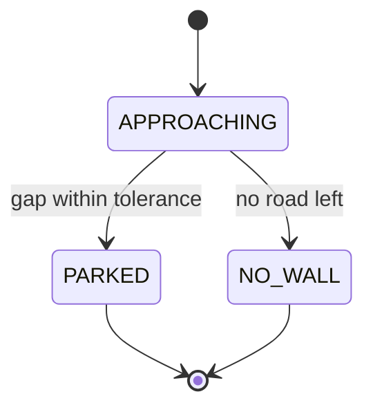

# Chapter 25: XRP Capstone Project

Twenty-four chapters ago, the Explorer was an empty project that printed one line. Today it drives a whole obstacle course on its own: a measured leg, a turn to a heading, a drive to the tape, and a state machine that follows the line to its end. It is built from subsystems and commands, characterized with SysId, tuned live from a dashboard, guarded by thirty tests that run on every push, and it keeps a log of every run that you can replay on your laptop, loop by loop.

That is a lot of robot. This chapter does not add a new kind of tool to it. Instead, you will use every tool you already have, on purpose, in the right order, the way a team does in build season. You and a partner will **design** one more leg of the course, **write the tests** for it before the code, **build** it, give the simulator a way to run it, **tune** it on the floor, **prove** it works with logs, and then **ship** the Explorer as a real, tagged release: version 1.0.0.

The new leg is short to describe. When the line ends, the robot drives on toward a wall and **parks** in front of it, a set distance away, using the rangefinder. It is short on purpose. The point of a capstone is not a big feature; it is doing every step of the work properly, and finishing.

By the end of the chapter, you and your partner will have:

- a **design doc**, reviewed and merged as a pull request before any code was written,
- a new command, `ParkAtWall`, with a small state machine and a **pure** decision method, tested first and written second,
- a pretend wall on the simulated floor, so the whole four-leg course runs in a test, with **38 tests** in all,
- three clean runs in a row on the real floor, each one checked in its log,
- every log stamped with the exact commit of code that made it,
- a GitHub **release**, tagged `v1.0.0`, and a short demo video.

On the Java side, you will learn **records**: a one-line way to write a small class that only holds values, like a decision with two parts. You have been using records since Chapter 16 without knowing it.

The plan fits in **two lab meetings**, with the video finished at home. It works best with a partner at about the same point in the book. You will need your XRP, your strip of tape from Chapter 21, and something flat and hard to be the wall: a cardboard box, or a stack of books.

---

## 25.1 What "Done" Looks Like

Every chapter so far has told you exactly what to build. A capstone is different: the plan is part of the work. And a plan starts at the end, with a clear answer to one question: **how will we know we are done?**

Engineers call that answer the **acceptance criteria**: a short list of checks that anyone could run, which all pass when the work is finished and not before. Writing them first does two things. It stops a project from growing forever ("while we are in here, let's also..."), and it turns "it works, I think" into "it passed all eight checks, and here is the proof."

Here are the capstone's acceptance criteria. Read them now; Section 25.10 ends with you checking every one.

1. A **design doc** for leg 4 is merged into `main`, reviewed by your partner, before any leg 4 code.
2. `ParkAtWall` decides with a **pure** method, and every arrow of its state machine has a test.
3. The **simulated** course runs all four legs in `ObstacleCourseTest`, and parks.
4. **All tests pass**, on your laptop and on GitHub, with a green check on every pull request.
5. On the real floor, the course runs **three times in a row** with no touching, ending parked.
6. Each of those runs has a **log**, and a replay of one of them matches it.
7. The release has `TUNING_MODE` off, `ROBOT_MODE` on `REAL`, and every log records its **commit**.
8. `main` is tagged **`v1.0.0`**, with a GitHub release and a **demo video**.

> **"Done" is a list, not a feeling**
>
> Every team has a robot that "basically works." Basically works means it worked once, while someone watched, and nobody wrote down how. A list of checks makes "done" something you can prove to a mentor, a teammate, or yourself next month. You will see the same idea on a bigger scale in Chapter 39, where the competition-day checklist decides whether code is allowed onto the robot at all.

### Who does what

As in every Collab lab since Chapter 11, the **owner** is the partner whose Explorer repository you use, and the **teammate** is the other partner. The whole capstone happens in the owner's repository. Check that the teammate is still a collaborator on it (**Settings** > **Collaborators**, as in Chapter 11's Collab lab), and that the teammate has cloned it.

The teammate's own Explorer stays as it is at the end of Chapter 24. That is fine: Chapter 26 starts a brand-new project for a new robot, and both partners' names go on the capstone release.

Both partners need the owner's repository at the end of Chapter 24: **30 tests**, all green, merged into `main`. If one of you is not quite there, use the owner's, since that is the code you will build on.

### The two meetings

| When | What you do | Done when |
|---|---|---|
| **Meeting 1** | Write the design doc together (Section 25.3), open it as a PR, review, merge. Then write the tests and the code for leg 4, and the pretend wall (Sections 25.4 to 25.7). | The leg 4 pull request is open, with a green check |
| **Meeting 2** | Merge leg 4 and tune it on the floor (Section 25.8). Prepare the release (Section 25.9), then run the course three times, check the logs, tag it, and publish it (Section 25.10). | `v1.0.0` is on GitHub |
| **At home** | Edit and upload the demo video, and add its link to the release. | The release page has the video link |

If meeting 1 runs over, the floor work in Section 25.8 can start with the pull request still open: tune on the leg 4 branch, and merge when the green check comes back.

> **Ahead, or behind?**
>
> If you finish early, the Exercises have a menu of **extensions**: more legs and smarter parking, each one a small project with its own design doc and its own release, `v1.1.0`. If you are behind, do the capstone with the smallest scope that meets the eight checks, and save the extensions for the catch-up meetings at the end of the season. Shipping a small thing that works beats half-building a big thing, every time.

---

## 25.2 The Leg 4 Challenge

Here is the course as it stands, one row per step of the `Course/Step` timeline from Chapter 24:

| Step | Command | Ends when |
|---|---|---|
| Reset Pose | `resetPose()` | at once |
| Leg 1 | `DriveDistance` | the distance PID reaches 0.50 m |
| Turn | `TurnToHeading` | the heading PID reaches 90 degrees |
| Leg 2 | `DriveUntilLine` | either reflectance sensor sees the crossbar |
| Leg 3 | `FollowLine` (if there is a line) | the line ends, or the search gives up |
| Done | `holdStill()` | autonomous ends |

Leg 4 goes between Leg 3 and Done. Stand a **wall** on the floor past the end of the tape, square to the line, about 30 cm beyond its end. When the line ends, the robot drives on, straight ahead, and stops when the rangefinder reads **10 cm**. If no wall turns up within 60 cm, it gives up and stops anyway.

Why this leg? Because it uses a little of everything. It needs a **command** that requires the drivetrain, a sensor that is read through an **IO layer**, a small **state machine**, a **P controller**, a **tunable** number, a **pure** method that tests can question, a new piece of the **simulated** floor, and new **outputs** in the log. And because it is the last leg, it is the one a judge, a mentor, or your future self will see the robot finish with.

### How the rangefinder sees, and what that means for parking

Section 9.6 introduced the rangefinder: a tiny speaker and a tiny microphone that time an ultrasonic echo. Parking leans on it harder than anything has so far, so it is worth one more look.

Sound travels about 343 meters per second in room-temperature air, and the chirp goes out **and back**, so:

```
distance = 343 m/s x echo time / 2
```

An echo after 1 millisecond means the wall is about 0.17 meters away. The sensor turns that time into a voltage, and `XRPRangefinder.getDistanceMeters()` turns the voltage back into meters: 5 volts means 4 meters, the most it reports. (Ctrl+click `XRPRangefinder` in VS Code and read it: the whole conversion is one line, `(voltage / 5.0) * 4.0`.)

Now take Section 9.6's list of habits, and ask what each one does to a robot trying to park:

- **It sees a cone, not a line.** A chair leg beside the course can be "the wall," and the robot parks in front of nothing.
- **Soft and slanted surfaces are hard to hear.** If the echo never comes back, the reading jumps toward 4 meters, and the robot drives on, looking for a wall that is right in front of it. That is why leg 4 needs a safety distance.
- **Too close is a blind spot.** One reason to park at 10 cm, not 2.
- **It flickers.** A noisy reading near the target can make the robot twitch back and forth. A tolerance (park when "close enough") is the simple answer.

> **Choose a good wall**
>
> Use something hard, flat, and wider than the robot: a cardboard box, a hardcover book standing up, a wooden board. Stand it square to the line, so the chirp bounces straight back. Clear anything else out of the robot's way for half a meter on either side of the line. Most "the rangefinder is broken" reports in a lab turn out to be "the wall is a backpack."

### Parking is a P controller

How fast should the robot drive toward the wall? Full speed until the right distance, then stop, would hit the wall: a moving robot cannot stop instantly (Chapter 16's kA is exactly how much it resists). Creeping the whole way is slow, and wastes autonomous time.

You already know the answer from Chapter 15: drive at a speed **proportional** to how far you still have to go. Call the difference between what the rangefinder reads and the park distance the **gap**. Then:

```
speed = kP x gap
```

With `kP = 1.5`, a gap of 0.20 m asks for 0.30 m/s (capped at the Explorer's autonomous speed, 0.20 m/s), a gap of 0.06 m asks for 0.09 m/s, and a gap of 0.01 m asks for 0.015 m/s. The robot slows as it closes in. And if it overshoots, the gap goes **negative**, so the speed does too, and the robot backs up. That is the same P controller as `DriveDistance`'s distance controller, with one difference that matters: its measurement comes from the **wall**, not from the encoders, so it parks in the right place even if leg 3 ended a few centimeters early.

> **The same shape, with a camera**
>
> In Chapter 33, the Mini Swerve will drive up to an AprilTag and stop in front of it, using a camera instead of a rangefinder. Underneath, it is this leg: measure the gap to a target with a sensor, drive at a speed proportional to it, and stop inside a tolerance. The sensor gets much fancier. The idea does not change.

---

## 25.3 Plan Before You Type: The Design Doc

On a team, nobody writes a new feature for the competition robot without telling anyone. Someone writes down what they plan to do, and the team reads it first. That written plan is a **design doc**. It is usually a page or two, it lives in the repository next to the code, and it is reviewed like code, in a pull request.

Why bother, for something you could just start typing? Because a plan is the cheapest place to find a mistake. Changing a sentence in a design doc takes ten seconds. Changing a command after it has tests, a simulation, and a tuned gain takes an afternoon. And a design doc gives your partner something to review **before** the work, when "I think that state is missing" is easy to act on, instead of after, when it means starting over.

### The template

Here is a template with the questions every design doc in this book answers. Each heading is a question your partner, or a mentor, will ask anyway.

```markdown
# Design: <the feature's name>

Authors: <both names>

## Goal
What should the robot do, in one or two sentences, that it cannot do now?

## Done means
The checks that prove it works. Anyone should be able to run them.

## What changes
Every class that is new or changes, and how.

## States
The state diagram and the transition table (Chapter 21), if there is a state machine.

## Tests
Each test, as a sentence, before any code exists.

## Simulation
How the simulated robot will be able to do it.

## Logging
What will be recorded, so a log can show it worked (or why not).

## Tuning
Which numbers will be tuned, and how.

## Risks
What could go wrong, and what we will do about it.

## Who does what
Who writes which part, and who reviews it.
```

### The leg 4 design doc, filled in

Here is the template filled in for leg 4. Read it carefully: it is also your map of the rest of this chapter. Your own doc should say the same things in your own words, with your own numbers and names.

```markdown
# Design: Leg 4, Park at the Wall

Authors: Sam Rivera, Alex Chen

## Goal
After the line ends, the Explorer drives straight on toward a wall and stops
10 cm in front of it, measured by the rangefinder. Autonomous then holds still.

## Done means
- In simulation, ObstacleCourseTest runs all four legs and ends with the
  rangefinder within 3 cm of 10 cm, still on the line.
- On our floor, three runs in a row end parked, without touching the wall.
- If the wall is missing, the robot stops after 60 cm and says NO_WALL.

## What changes
- New: commands/ParkAtWall, a command with a state machine (requires the
  drivetrain, reads Sensors). Its decision is a pure static method, decide().
- New: test ParkAtWallTest (pure, no HAL).
- Changed: SensorsIOSim gets a pretend wall; new test SensorsIOSimTest.
- Changed: CourseConstants gets the wall's position, the park distance, and
  the leg 4 safety distance.
- Changed: RobotContainer adds leg 4 to the course and a "Park At Wall Only"
  routine to the chooser.
- Changed: ObstacleCourseTest checks that the robot parked.

## States
APPROACHING (start) -> PARKED     when the gap is within 2 cm
APPROACHING         -> NO_WALL    when the safety distance runs out
PARKED and NO_WALL are finished states: stay there, stopped.
In APPROACHING, speed = kP x gap, capped at the auto speed. Negative backs up.

## Tests
1. A far wall means full auto speed.
2. A small gap means a slow approach (kP x gap).
3. Too close means back up.
4. Inside the tolerance means PARKED, stopped.
5. No road left means NO_WALL, stopped.
6. PARKED stays PARKED.
7. Sim: facing the wall, the rangefinder reads the gap to it.
8. Sim: facing away, it reads clear (4 m).

## Simulation
SensorsIOSim works out where a straight beam from the rangefinder meets the
wall, which runs across the line 30 cm past its end.

## Logging
ParkAtWall/State and ParkAtWall/SpeedMetersPerSecond every loop; the
course timeline gets a "Leg 4" step. Sensors/DistanceAheadMeters is already
an input.

## Tuning
Park kP on the Tuning tab, with the "Park At Wall Only" routine. Start at 1.5.

## Risks
- The rangefinder misses a soft or slanted wall: use a box, square to the line.
- The robot hits the wall if kP is too high: start low, raise it slowly.
- Leg 3 ends crooked, so the beam misses the wall: NO_WALL stops the robot
  safely; check the heading at the end of leg 3 in the log.

## Who does what
Both: this doc. Pair programming on leg 4 (switching every step).
Owner opens the leg 4 PR, teammate reviews. Teammate opens the release PR,
owner reviews.
```

Walk through what makes this a good one:

- **"Done means" is checkable.** "Parks nicely" is not a check. "Within 3 cm of 10 cm" is.
- **"What changes" lists every file.** A reviewer can see the size of the job at a glance, and spot a forgotten piece (the course test!) before anyone writes code.
- **The tests are sentences.** Writing them before the code forces you to decide exactly what "too close" should do. Writing the code first tempts you to make the tests match whatever the code happened to do.
- **"Risks" plans for failure.** Every risk has an answer. The NO_WALL state exists because of the third risk.

### Drawing the state diagram

The design doc above writes the state diagram in plain text, which works anywhere. If you would like a real picture, GitHub can draw one for you: it turns a block of **Mermaid** code in a Markdown file into a diagram on the page. Paste this under `## States`:

````markdown

````

On GitHub, in the file and in the pull request, that block shows up as boxes and arrows. In VS Code's Markdown preview it stays as text, which is fine: the text version is readable too. (The book itself shows it as text, as you can see.)

### Step 1: Write it together

Make a branch for the design doc, in the owner's repository, on the owner's laptop:

```bash
git checkout main
git pull
git checkout -b design-leg-4
```

Create a folder named `docs` at the top of your project (next to `src`), and a file in it named `leg-4-design.md`. Sit together, and fill in the template for leg 4. Talk through each heading before you write it. The doc above is an example: argue with it. Do you want 10 cm, or 15? A 30 cm wall gap, or what fits your floor? Is there a risk it missed?

### Step 2: Open it as a pull request

```bash
git add docs/leg-4-design.md
git commit -m "Ch25: Design doc for leg 4, park at the wall"
git push -u origin design-leg-4
```

Open a pull request on GitHub (Section 11.3). In its description, write one line: what you would like the reviewer to check most carefully.

### Step 3: Review it

The **teammate** reviews, even though you wrote it together. Reviewing your own plan, in the **Files changed** tab, with fresh eyes, is different from writing it. Use these questions, and leave at least two comments:

- Could someone who was not here run every check in **Done means**?
- Does every state have a way out, or is it a finished state?
- Does every arrow in **States** have a test in **Tests**?
- Is there a file in **What changes** with no test, or a test for a file that is not listed?
- Is there a risk that is not listed?

Fix what the review finds, in new commits on the same branch. Then the teammate approves, and the owner merges (**Create a merge commit**, as always) and deletes the branch. Check one acceptance criterion off: the plan is in `main`.

> **The doc is allowed to change**
>
> You will learn things while building leg 4 that the doc did not know. That is normal. When the plan changes, change the doc in the same pull request as the code, so the doc and the code never disagree. A design doc that describes a robot that does not exist is worse than none.

---

## 25.4 New Java: Records

Look at the **States** section of your design doc again. On every loop, `ParkAtWall` has to answer two questions at once: **which state** should it be in, and **how fast** should it drive?

In Chapter 22, you learned to put a command's decision into a **pure** method: every fact comes in as a parameter, and the answer comes out as the return value. A pure method can be tested by asking it questions, with no robot. That is exactly what you want here. But a Java method returns **one** value, and this decision has **two** parts.

`FollowLine` got around that with two steps: one method decides the state, and then a switch turns the state into speeds. That works when the speed depends only on the state. Here it does not: in `APPROACHING`, the speed depends on the gap, which is the same fact the state decision uses. You want one method that looks at the facts once and answers both parts together.

### The long way: a data class

Section 13.5 showed you how to bundle values: a small class whose job is to hold them. Here is a careful version for the decision, with everything a good value class needs:

```java
/** One loop's decision: which state to be in, and how fast to drive. */
public final class Decision {

    private final State state;
    private final double speedMetersPerSecond;

    public Decision(State state, double speedMetersPerSecond) {
        this.state = state;
        this.speedMetersPerSecond = speedMetersPerSecond;
    }

    public State getState() {
        return state;
    }

    public double getSpeedMetersPerSecond() {
        return speedMetersPerSecond;
    }

    // ...plus equals(), hashCode(), and toString(), another 20 lines
}
```

It is immutable, like `Pose2d` (Chapter 14): `private final` fields, set once in the constructor, with getters and no setters. That part is good. But it is fifteen lines of boilerplate before you even start on `equals()`, which you need if a test is going to compare two decisions, and which is easy to get subtly wrong. All of that, for two values.

### The short way: a record

Java has a shorter way to write exactly this kind of class:

```java
/**
 * One loop's decision: which state to be in, and how fast to drive.
 *
 * @param state the state to be in after this loop
 * @param speedMetersPerSecond how fast to drive; negative backs up
 */
public record Decision(State state, double speedMetersPerSecond) {}
```

That is a **record**: a class whose whole job is to hold a fixed set of values. The word `record` replaces `class`, and the parentheses after the name list the values it holds, called its **components**. The empty braces are the body. Java writes everything else for you:

| You write | Java writes for you |
|---|---|
| `record Decision(State state, double speedMetersPerSecond)` | a `private final` field for each component |
| | a constructor that takes them in order: `new Decision(State.PARKED, 0.0)` |
| | an **accessor** for each: `state()` and `speedMetersPerSecond()` |
| | `equals()`: two decisions are equal if every component is equal |
| | `hashCode()`, which always agrees with `equals()` |
| | `toString()`: `Decision[state=PARKED, speedMetersPerSecond=0.0]` |

Three of those deserve a closer look.

**The accessors have no `get`.** A record's accessor is named exactly like its component: `decision.state()`, not `decision.getState()`. Try the second, and Java says:

```
error: cannot find symbol
        double s = d.getSpeedMetersPerSecond();
                    ^
  symbol:   method getSpeedMetersPerSecond()
  location: variable d of type Decision
```

**A record is immutable.** Its fields are `final`, so once a decision is made, it cannot be changed. Try `decision.speedMetersPerSecond = 0.1;`, and:

```
error: cannot assign a value to final variable speedMetersPerSecond
```

If you want a different decision, make a new one. That is Chapter 14's rule for immutable objects, enforced by the language.

**`equals()` compares the values.** Since Chapter 10 you have known that `==` on two objects asks "are these the **same** object?" Two separate `new Decision(State.PARKED, 0.0)` objects are not the same object, so `==` says `false`. But `equals()` asks "do they hold the same values?", and a record's `equals()` says `true`. That is what makes records wonderful in tests:

```java
assertEquals(new Decision(State.PARKED, 0.0),
    ParkAtWall.decide(State.APPROACHING, 0.01, 0.60, 1.5));
```

One assertion checks the whole answer. And when it fails, the record's `toString()` makes the message easy to read:

```
expected: <Decision[state=PARKED, speedMetersPerSecond=0.0]> but was: <Decision[state=APPROACHING, speedMetersPerSecond=0.015]>
```

> **Records compare doubles exactly**
>
> A record's `equals()` compares a `double` component **exactly**, with no tolerance. Remember Chapter 12: `0.1 + 0.2` is not exactly `0.3` in a computer. So `new Decision(State.APPROACHING, 0.1 + 0.2).equals(new Decision(State.APPROACHING, 0.3))` is `false`. Compare whole records when the numbers are exact, like `0.0` for "stopped" or a constant passed straight through. When a component is **computed**, check the parts separately, with a delta for the `double`: `assertEquals(State.APPROACHING, decision.state())` and `assertEquals(expected, decision.speedMetersPerSecond(), DELTA)`. You will see both kinds in Section 25.5.

### What a record cannot do

A record is not a general-purpose class, on purpose:

- **No extra fields.** Every value it holds must be a component. Add `private double extra;` inside the braces and Java says `field declaration must be static`, and suggests: `(consider replacing field with record component)`.
- **No changing.** Every field is `final`. A record cannot be a robot part whose readings change every loop, or a command whose state moves. `Drivetrain` and `ParkAtWall` are classes, and always will be.
- **No `extends`.** Every record secretly extends Java's `Record` class, the way every enum extends `Enum` (Section 24.4), so it cannot extend anything else. It **can** `implements` an interface.

It **can** have methods of its own in its braces, and `static` constants. And a record written inside another class is automatically `static`, just like a nested enum (Section 21.3), so `ParkAtWall.Decision` needs no `ParkAtWall` object.

The rule of thumb: **if a class only carries values from one place to another, and they never change, make it a record.** If it does things, or remembers things that change, it is a class.

### You have been using records since Chapter 16

In Chapter 16, `Meters.of(0.5)` gave you a `Distance`. Ctrl+click `of` in VS Code and follow it, and you land in WPILib's units library, at a class that begins:

```java
public record ImmutableDistance(double magnitude, double baseUnitMagnitude, DistanceUnit unit) implements Distance {
```

A record with three components that implements an interface: every measure you made with `Volts.of(...)` or `Meters.of(...)` was one. It was a good fit for the same reason `Decision` is: a measurement is a few values that belong together and never change.

> **AdvantageKit can log a whole record**
>
> `Logger.recordOutput` has a version that takes any record, and AdvantageScope shows its components as a folder of fields. It works well for records of numbers, booleans, enums, and WPILib types like `Pose2d`. There is one catch, from AdvantageKit's documentation: the **first** time a record type is logged, AdvantageKit has to work out how to store it, which can take more than 100 ms, five whole loops. Its advice is to log each record type for the first time while the robot is disabled. `ParkAtWall` runs in the middle of autonomous, so it logs the decision's two parts separately instead: an enum and a `double`, which cost nothing. Exercise 4 tries the record version.

---
## 25.5 Tests First

Your design doc lists six tests for `ParkAtWall`'s decisions, as sentences. Chapter 22 taught you to write a test, watch it fail, and only then make it pass. This time, go one step further: write **all** the tests for a new feature before its code exists. That way of working is called **test-driven development** (Chapter 22 named it), and a capstone is the perfect place to try it, because the design doc has already decided what every answer should be.

### Two people, one keyboard

From here to the end of Section 25.7, you write code together, on the owner's laptop. Teams do that with a habit called **pair programming**:

- One partner is the **driver**: hands on the keyboard, typing.
- The other is the **navigator**: reading every line as it appears, thinking one step ahead, checking it against the design doc, and catching typos before the compiler does.
- **Switch** at every "Step" heading. Both of you should type some of every file.

It feels slow for the first ten minutes. Then you notice that the bugs the navigator catches in a second are the ones that would have cost the driver twenty minutes alone. Many professional teams pair on their trickiest code for exactly that reason.

Make the branch:

```bash
git checkout main
git pull
git checkout -b leg-4
```

### Step 1: Just enough of `ParkAtWall` for the tests to compile

A test calls methods by name, so it cannot compile until those names exist. Create `ParkAtWall.java` in the `commands` folder with only the outline: the states, the record, the two constants the tests use, and a `decide()` that is not written yet.

```java
package frc.robot.commands;

import edu.wpi.first.wpilibj2.command.Command;

/** Leg 4: park in front of a wall (Chapter 25). Only the decision's outline, so far. */
public class ParkAtWall extends Command {

    /** Everything the parking command can be doing. */
    public enum State {
        APPROACHING(false),   // the wall is ahead: close the gap, faster when it is bigger
        PARKED(true),         // the rangefinder reads the park distance: stop
        NO_WALL(true);        // drove the whole safety distance without parking: stop

        private final boolean done;

        State(boolean done) {
            this.done = done;
        }

        /** True for the states where the command has finished. */
        public boolean isDone() {
            return done;
        }
    }

    /**
     * One loop's decision: which state to be in, and how fast to drive.
     *
     * @param state the state to be in after this loop
     * @param speedMetersPerSecond how fast to drive; negative backs up
     */
    public record Decision(State state, double speedMetersPerSecond) {}

    // Starting values. Package-private, so ParkAtWallTest can use them.
    static final double PARK_KP = 1.5;                  // meters per second, per meter of gap left
    static final double PARK_TOLERANCE_METERS = 0.02;   // this close to the park distance counts

    static Decision decide(State state, double gapMeters, double metersLeft, double kP) {
        return new Decision(state, 0.0);   // not written yet: always stand still
    }
}
```

The `State` enum follows `FollowLine.State` exactly (Section 21.6): each state carries whether it is a finished state. The record is the one from Section 25.4, nested in the command because it only makes sense here.

Look at `decide()`'s parameters, because they are the design's most important choice. The robot knows two raw facts: what the rangefinder reads, and how far the robot has driven. The rules in the design doc do not care about either one directly. They care about **the gap** (reading minus park distance: positive is too far, negative is too close) and **the road left** (how much farther the safety limit allows). So the command will work out those two numbers from the robot, and hand them to `decide()`. That keeps the pure part as small as possible: it never needs to know the park distance or the safety limit, only how far from each the robot is.

### Step 2: The tests

Create `ParkAtWallTest.java` in `src/test/java/frc/robot/commands`, next to `FollowLineTest`. Switch drivers. Type it, do not paste:

```java
package frc.robot.commands;

import static org.junit.jupiter.api.Assertions.assertEquals;
import static org.junit.jupiter.api.Assertions.assertTrue;

import frc.robot.commands.ParkAtWall.Decision;
import frc.robot.commands.ParkAtWall.State;
import frc.robot.subsystems.Drivetrain;
import org.junit.jupiter.api.Test;

/** Tests for ParkAtWall's decisions. Pure: no robot, no HAL, no clock. */
class ParkAtWallTest {

    private static final double DELTA = 1e-9;
    private static final double PLENTY_OF_ROAD = 0.60;   // meters the safety limit still allows
    private static final double NO_ROAD_LEFT = 0.0;

    @Test
    void aFarWallMeansFullAutoSpeed() {
        assertEquals(
            new Decision(State.APPROACHING, Drivetrain.AUTO_DRIVE_METERS_PER_SECOND),
            ParkAtWall.decide(State.APPROACHING, 0.50, PLENTY_OF_ROAD, ParkAtWall.PARK_KP));
    }

    @Test
    void aSmallGapMeansASlowApproach() {
        Decision decision = ParkAtWall.decide(
            State.APPROACHING, 0.06, PLENTY_OF_ROAD, ParkAtWall.PARK_KP);

        assertEquals(State.APPROACHING, decision.state());
        assertEquals(ParkAtWall.PARK_KP * 0.06, decision.speedMetersPerSecond(), DELTA);
    }

    @Test
    void tooCloseMeansBackUp() {
        Decision decision = ParkAtWall.decide(
            State.APPROACHING, -0.06, PLENTY_OF_ROAD, ParkAtWall.PARK_KP);

        assertEquals(State.APPROACHING, decision.state());
        assertTrue(decision.speedMetersPerSecond() < 0.0, "should back up, but drove forward");
    }

    @Test
    void insideTheToleranceIsParked() {
        double almostThere = ParkAtWall.PARK_TOLERANCE_METERS / 2.0;

        assertEquals(new Decision(State.PARKED, 0.0),
            ParkAtWall.decide(State.APPROACHING, almostThere, PLENTY_OF_ROAD, ParkAtWall.PARK_KP));
    }

    @Test
    void noRoadLeftAndNoWallGivesUp() {
        assertEquals(new Decision(State.NO_WALL, 0.0),
            ParkAtWall.decide(State.APPROACHING, 3.90, NO_ROAD_LEFT, ParkAtWall.PARK_KP));
    }

    @Test
    void parkedStaysParked() {
        assertEquals(new Decision(State.PARKED, 0.0),
            ParkAtWall.decide(State.PARKED, 0.50, PLENTY_OF_ROAD, ParkAtWall.PARK_KP));
    }
}
```

Hold each test up against the design doc's list. They are the same six sentences, in the same order, turned into Arrange, Act, Assert (Section 22.2). A few details:

- **`import frc.robot.commands.ParkAtWall.Decision;`** imports a nested type by its full name, exactly as Chapter 20 imported `CourseConstants`. After that, the test can say `Decision` and `State` instead of `ParkAtWall.Decision`.
- **Whole records where the answer is exact.** `Drivetrain.AUTO_DRIVE_METERS_PER_SECOND` is a constant passed straight through (the speed is capped at it), and `0.0` is `0.0`, so those tests compare the whole decision in one `assertEquals`.
- **Parts with a delta where the answer is computed.** `aSmallGapMeansASlowApproach` multiplies, so it checks the state and the speed separately, with a delta, as Section 25.4's callout said.
- **`tooCloseMeansBackUp` checks only the sign.** The design doc says "too close means back up." It does not say how fast, and the test should not promise more than the design does.
- **`3.90` in `noRoadLeftAndNoWallGivesUp`** is what the gap looks like when the rangefinder reads its maximum, 4 meters, because there is no wall at all.

### Step 3: Watch them fail

Run **WPILib: Test Robot Code**. The build fails, and the report (Section 22.2) shows **36 tests, 5 failed**. Click `ParkAtWallTest`:

```
aFarWallMeansFullAutoSpeed()
    expected: <Decision[state=APPROACHING, speedMetersPerSecond=0.2]> but was: <Decision[state=APPROACHING, speedMetersPerSecond=0.0]>
insideTheToleranceIsParked()
    expected: <Decision[state=PARKED, speedMetersPerSecond=0.0]> but was: <Decision[state=APPROACHING, speedMetersPerSecond=0.0]>
noRoadLeftAndNoWallGivesUp()
    expected: <Decision[state=NO_WALL, speedMetersPerSecond=0.0]> but was: <Decision[state=APPROACHING, speedMetersPerSecond=0.0]>
aSmallGapMeansASlowApproach()
    expected: <0.09> but was: <0.0>
tooCloseMeansBackUp()
    should back up, but drove forward ==> expected: <true> but was: <false>
```

(The order may differ.) Look at how readable those are. Every failure says what the decision should have been and what it was, both parts, because a record's `toString()` writes them out. Your thirty old tests still pass: nothing they check has changed.

And look at the one new test that **passed**: `parkedStaysParked`. The placeholder `decide()` returns the state it was given with a speed of zero, which happens to be exactly the right answer for a parked robot. That is worth noticing. A test that passes before the code is written is not proving anything yet. It will start earning its keep later, the day someone changes `decide()` and accidentally lets a parked robot start driving again.

> **Red is the plan working**
>
> Five red tests feel like failure. They are the opposite: they are the design doc, turned into something the computer can check. Now your job is precise. You are not "writing a parking command"; you are making five specific tests pass without breaking thirty-one others. When the last one goes green, you are done with the decision, and you know it.

Do not commit or push yet. A push would run CI, and CI would (correctly) go red.

---

## 25.6 The `ParkAtWall` Command

Switch drivers. Replace everything in `ParkAtWall.java` with the whole command:

```java
package frc.robot.commands;

import edu.wpi.first.math.MathUtil;
import edu.wpi.first.math.controller.PIDController;
import edu.wpi.first.wpilibj2.command.Command;
import frc.robot.subsystems.Drivetrain;
import frc.robot.subsystems.Sensors;
import frc.robot.util.TunableNumber;
import org.littletonrobotics.junction.Logger;

/**
 * Drive straight at a wall and park a set distance in front of it, using the
 * rangefinder (Chapter 25): fast while the wall is far, slower as it gets close, and
 * backing up if the robot ends up too close. Gives up if no wall turns up.
 */
public class ParkAtWall extends Command {

    /** Everything the parking command can be doing. */
    public enum State {
        APPROACHING(false),   // the wall is ahead: close the gap, faster when it is bigger
        PARKED(true),         // the rangefinder reads the park distance: stop
        NO_WALL(true);        // drove the whole safety distance without parking: stop

        private final boolean done;

        State(boolean done) {
            this.done = done;
        }

        /** True for the states where the command has finished. */
        public boolean isDone() {
            return done;
        }
    }

    /**
     * One loop's decision: which state to be in, and how fast to drive.
     *
     * @param state the state to be in after this loop
     * @param speedMetersPerSecond how fast to drive; negative backs up
     */
    public record Decision(State state, double speedMetersPerSecond) {}

    // Starting values: the Tuning tab can change the gain (Chapter 25). Package-private,
    // so ParkAtWallTest can use them.
    static final double PARK_KP = 1.5;                  // meters per second, per meter of gap left
    static final double PARK_TOLERANCE_METERS = 0.02;   // this close to the park distance counts

    // Live-tunable copy of the gain, read every loop (a P controller has no memory).
    private static final TunableNumber parkKp = new TunableNumber("ParkAtWall/Park kP", PARK_KP);

    private final Drivetrain drivetrain;
    private final Sensors sensors;
    private final double parkDistanceMeters;
    private final double maxDistanceMeters;

    private final PIDController headingController = Drivetrain.createHeadingController();

    // Remembered from loop to loop. Set in initialize(), every run.
    private State state = State.APPROACHING;
    private double startDistanceMeters = 0.0;
    private double holdHeadingDegrees = 0.0;

    /**
     * Create a command that parks in front of a wall.
     *
     * @param drivetrain the drivetrain to drive
     * @param sensors the sensors whose rangefinder watches the wall (read only, never required)
     * @param parkDistanceMeters stop when the rangefinder reads this far
     * @param maxDistanceMeters give up after driving this far, wall or no wall
     */
    public ParkAtWall(Drivetrain drivetrain, Sensors sensors,
            double parkDistanceMeters, double maxDistanceMeters) {
        this.drivetrain = drivetrain;
        this.sensors = sensors;
        this.parkDistanceMeters = parkDistanceMeters;
        this.maxDistanceMeters = maxDistanceMeters;
        addRequirements(drivetrain);
    }

    @Override
    public void initialize() {
        state = State.APPROACHING;
        startDistanceMeters = drivetrain.getAverageDistanceMeters();
        holdHeadingDegrees = drivetrain.getHeadingDegrees();
        headingController.reset();
        Drivetrain.useLatestHeadingGains(headingController);
        System.out.println("ParkAtWall started " + sensors.getDistanceAheadMeters()
            + " m from the wall, at " + drivetrain.getPose());
    }

    @Override
    public void execute() {
        // 1. Decide: the thin part gathers the facts, the pure part decides.
        Decision decision = decide(
            state, getGapMeters(), maxDistanceMeters - getTraveledMeters(), parkKp.get());
        if (decision.state() != state) {
            System.out.println("ParkAtWall: " + state + " -> " + decision.state());
            state = decision.state();
        }

        // 2. Act: drive at the decided speed, holding the heading we started with.
        double turnRate = MathUtil.clamp(
            headingController.calculate(drivetrain.getHeadingDegrees(), holdHeadingDegrees),
            -Drivetrain.AUTO_TURN_RADIANS_PER_SECOND, Drivetrain.AUTO_TURN_RADIANS_PER_SECOND);
        drivetrain.drive(decision.speedMetersPerSecond(), turnRate);

        Logger.recordOutput("ParkAtWall/State", state);
        Logger.recordOutput("ParkAtWall/SpeedMetersPerSecond", decision.speedMetersPerSecond());
    }

    @Override
    public boolean isFinished() {
        return state.isDone();
    }

    @Override
    public void end(boolean interrupted) {
        drivetrain.stop();
        System.out.println("ParkAtWall " + (interrupted ? "interrupted" : "finished")
            + " in " + state + ", " + sensors.getDistanceAheadMeters() + " m from the wall");
    }

    /**
     * The decision (Chapter 25): given the state we are in, how far the robot still is
     * from where it should stop, and how far it may still drive, what next? A pure
     * function: every fact comes in as a parameter, and it changes nothing.
     *
     * @param state the state the command is in now
     * @param gapMeters the rangefinder reading minus the park distance; negative is too close
     * @param metersLeft how much farther the safety limit allows the robot to drive
     * @param kP how fast to drive, in meters per second, for each meter of gap
     * @return the state to be in next, and how fast to drive
     */
    static Decision decide(State state, double gapMeters, double metersLeft, double kP) {
        return switch (state) {
            case APPROACHING -> approach(gapMeters, metersLeft, kP);
            case PARKED, NO_WALL -> new Decision(state, 0.0);   // finished: stay finished, stopped
        };
    }

    /** Still approaching. Parked yet? Out of road? If neither, how fast? */
    private static Decision approach(double gapMeters, double metersLeft, double kP) {
        if (Math.abs(gapMeters) <= PARK_TOLERANCE_METERS) {
            return new Decision(State.PARKED, 0.0);
        }
        if (metersLeft <= 0.0) {
            return new Decision(State.NO_WALL, 0.0);
        }
        double speed = MathUtil.clamp(kP * gapMeters,
            -Drivetrain.AUTO_DRIVE_METERS_PER_SECOND, Drivetrain.AUTO_DRIVE_METERS_PER_SECOND);
        return new Decision(State.APPROACHING, speed);
    }

    /** How far the robot is from where it should stop, in meters; negative is too close. */
    private double getGapMeters() {
        return sensors.getDistanceAheadMeters() - parkDistanceMeters;
    }

    /** How far the robot has driven since this command started, in meters. */
    private double getTraveledMeters() {
        return drivetrain.getAverageDistanceMeters() - startDistanceMeters;
    }
}
```

Almost nothing in it is new. That is the point of a capstone: every piece comes from a chapter you have finished. Walk through it as a tour of the book:

- **The shape is `FollowLine`'s** (Chapters 21 and 22): an enum of states with `isDone()`, decide then act in `execute()`, a pure static method for the decision, and a thin part that gathers the facts.
- **The pure part returns a record** (Section 25.4), so it can answer "which state" and "how fast" together. The switch expression has no `default` (Section 21.4): add a fourth state, and it stops compiling until you decide what the new state does.
- **`approach()` is a P controller** (Chapter 15), written out by hand because it is one multiplication: `kP * gapMeters`, clamped to the autonomous speed with `MathUtil.clamp`. It checks "parked?" before "out of road?", so a robot that reaches the wall on the very last centimeter of its safety distance still counts as parked.
- **The heading hold is `DriveUntilLine`'s** (Section 19.6): its own heading controller, from the factory, with the latest gains applied in `initialize()` (Chapter 23), holding the heading the command started with. The rangefinder only sees straight ahead, so driving straight matters.
- **`parkKp` is a `TunableNumber`** (Chapter 23), read **every loop**, like the follower's steering gain, and for the same reason: a P controller has no memory, so a new gain can take effect mid-run without a jump. The constant `PARK_KP` is its starting value, and stays package-private so the tests can use it.
- **The gap and the road left are worked out in the thin part,** from the rangefinder and the encoders, in two private helpers. Distances are measured from where the command started, never by resetting the encoders (Chapter 12's rule).
- **Two outputs, every loop** (Chapter 24): the state, as an enum, and the speed the decision asked for. The rangefinder's reading is already in the log as an input, under `Sensors`.
- **`end()` stops the drivetrain** however the command ends. On the loop that decides `PARKED`, `execute()` still sends one drive call with a speed of zero; then `isFinished()` returns `true`, and `end()` stops the motors in the same loop.

Run the tests. **36 tests, 0 failures.** Five red tests went green, and nothing else changed color.

Now commit, with both of your names on it. GitHub gives a commit to more than one person if its message ends with a **`Co-authored-by:`** line (a "trailer") for each extra author, after a blank line. Two `-m` options make two paragraphs, which puts the blank line there for you:

```bash
git add .
git commit -m "Ch25: ParkAtWall, its decisions tested first" -m "Co-authored-by: Alex Chen <alexchen@users.noreply.github.com>"
```

Use your partner's name, and the email address their GitHub account uses for commits. If they keep their email private, GitHub gives them a "noreply" address (they can find it in their GitHub **Settings** > **Emails**). Once pushed, the commit shows both partners' pictures on GitHub.

---

## 25.7 A Wall for the Simulator, and Leg 4 in the Course

`ParkAtWall` is written and tested, but nothing runs it yet. This section wires it into the course, and gives the simulated robot something to park in front of, so that `ObstacleCourseTest` can check all four legs.

### Step 1: The course's new numbers

Switch drivers. In `Constants.java`, add these to `CourseConstants`, after `END_POSE`:

```java
// Leg 4 (Chapter 25): a wall past the end of the line, and parking in front of it.
public static final double WALL_GAP_METERS = 0.30;             // end of the tape to the wall, measured
public static final double WALL_Y_METERS =                     // where the wall's face is, in field coordinates
    LINE_DISTANCE_METERS + FOLLOW_LINE_LENGTH_METERS + WALL_GAP_METERS;
public static final double PARK_DISTANCE_METERS = 0.10;        // the rangefinder reading to stop at
public static final double LEG_4_MAX_DISTANCE_METERS = 0.60;   // safety net: no wall this far, give up
```

`WALL_GAP_METERS` is a measurement, like `LINE_DISTANCE_METERS` in Chapter 14: once your wall is standing on the floor, measure from the end of the tape to the wall's face, and type your number. `WALL_Y_METERS` is computed from it, so it moves when you re-measure. In the field frame from Chapter 14, leg 3 runs up the y axis, so a wall across the end of the line sits at one y value. Only the simulator uses `WALL_Y_METERS`; the real robot uses the real wall.

The safety distance is twice the gap, which leaves room for leg 3 ending early, but stops a robot whose rangefinder sees nothing long before it wanders off your table.

### Step 2: The pretend wall

Open `SensorsIOSim.java`. Since Chapter 24, its rangefinder has always reported a clear road, 4 meters. Now it needs to see a wall.

Add two constants, after `CLEAR_AHEAD_METERS`:

```java
// Where the rangefinder sits, and how wide the wall is (Chapter 25). Package-private,
// so SensorsIOSimTest can use them.
static final double RANGEFINDER_AHEAD_METERS = 0.07;             // ahead of the robot's center
static final double WALL_HALF_WIDTH_METERS = 0.15;               // a 30 cm wall
```

In `updateInputs()`, change the rangefinder's line:

```java
inputs.distanceAheadMeters = distanceToPretendWall(pose);
```

and add this method, just before `isOnPretendTape()`:

```java
/**
 * What the rangefinder reads on the pretend floor (Chapter 25). The wall runs across
 * the field at CourseConstants.WALL_Y_METERS, centered on the line to follow. The
 * rangefinder sees it only if a straight line out of its front hits the wall.
 *
 * @param robotPose where the robot is on the field
 * @return the distance to the wall in meters, or 4 meters if the way ahead is clear
 */
private static double distanceToPretendWall(Pose2d robotPose) {
    // Robot frame to field frame: where is the rangefinder, and which way does it face?
    Pose2d rangefinder = robotPose.transformBy(
        new Transform2d(RANGEFINDER_AHEAD_METERS, 0.0, new Rotation2d()));
    double towardWall = rangefinder.getRotation().getSin();   // 1.0 facing it, 0 or less facing away
    if (towardWall <= 0.0) {
        return CLEAR_AHEAD_METERS;
    }

    // How far along the beam to the wall's line, and where along the wall the beam lands.
    double distance = (CourseConstants.WALL_Y_METERS - rangefinder.getY()) / towardWall;
    double hitX = rangefinder.getX() + distance * rangefinder.getRotation().getCos();
    boolean hitsWall = distance >= 0.0
        && Math.abs(hitX - CourseConstants.LEG_1_DISTANCE_METERS) <= WALL_HALF_WIDTH_METERS;
    return hitsWall ? Math.min(distance, CLEAR_AHEAD_METERS) : CLEAR_AHEAD_METERS;
}
```

Update the class's Javadoc to mention the wall, too ("the course's T of tape and the wall past its end are where `CourseConstants` says they are").

It is the same trick as `isOnPretendTape()` from Chapter 21, with one more idea. Take it in three steps:

1. **Where is the rangefinder?** `transformBy` moves from the robot's center to a point 7 cm ahead of it, in the robot's own frame, and gives back where that point is in the **field** frame (Section 21.8). The result is a `Pose2d`, so it also knows which way the rangefinder faces.
2. **Is it facing the wall at all?** The wall runs across the field, and the robot faces it when it points up the y axis. `getSin()` of its heading says how much: 1.0 straight at the wall (90 degrees), 0 along it, and negative facing away. If it is not facing the wall, the beam can never reach it.
3. **Where does the beam hit?** The wall is `WALL_Y_METERS - rangefinder.getY()` meters away **in y**. A beam that leaves at an angle has to travel farther than that to cover the same y distance, so divide by the sine: that is the distance along the beam. Then follow the beam that far in x, using the cosine, and check that it lands on the wall, within its half-width of the line.

That is a tiny version of **ray casting**: follow a straight line out from a sensor, and find the first thing it hits. Robot simulators, video games, and the 3D view in AdvantageScope all use the same idea. The real rangefinder's beam is a cone, not a line (Section 25.2), so the pretend one is a little **pickier** than the real one. That is fine for a simulator: if the code parks with a picky sensor, it will park with a forgiving one.

`RANGEFINDER_AHEAD_METERS` is a pretend number, like the reflectance sensors' 5 cm in Chapter 21. If you want the simulator to match your robot more closely, measure from the middle of the wheels to the front of the rangefinder, and use your number.

### Step 3: Two tests for the wall

The pretend wall is code, so it gets tests. They are pure: a `SensorsIOSim` only needs a pose, and a lambda can hand it one. Create `SensorsIOSimTest.java` in `src/test/java/frc/robot/subsystems`, next to `SensorsTest`:

```java
package frc.robot.subsystems;

import static org.junit.jupiter.api.Assertions.assertEquals;

import edu.wpi.first.math.geometry.Pose2d;
import edu.wpi.first.math.geometry.Rotation2d;
import frc.robot.Constants.CourseConstants;
import frc.robot.subsystems.SensorsIO.SensorsIOInputs;
import org.junit.jupiter.api.Test;

/** Tests for the pretend floor's wall. Pure geometry: no robot, no HAL. */
class SensorsIOSimTest {

    private static final double DELTA = 1e-9;

    /** What the pretend sensors report with the robot at one pose. */
    private static SensorsIOInputs readAt(Pose2d pose) {
        SensorsIOInputs inputs = new SensorsIOInputs();
        new SensorsIOSim(() -> pose).updateInputs(inputs);
        return inputs;
    }

    @Test
    void facingTheWallReadsTheGapToIt() {
        // Half a meter from the wall's face to the rangefinder, facing straight at it.
        double centerY = CourseConstants.WALL_Y_METERS - 0.50 - SensorsIOSim.RANGEFINDER_AHEAD_METERS;
        Pose2d facingWall = new Pose2d(
            CourseConstants.LEG_1_DISTANCE_METERS, centerY, Rotation2d.fromDegrees(90.0));

        assertEquals(0.50, readAt(facingWall).distanceAheadMeters, DELTA);
    }

    @Test
    void facingAwayFromTheWallReadsClear() {
        Pose2d facingAway = new Pose2d(
            CourseConstants.LEG_1_DISTANCE_METERS, 0.80, Rotation2d.fromDegrees(-90.0));

        assertEquals(4.0, readAt(facingAway).distanceAheadMeters, DELTA);
    }
}
```

Two small things to notice. `readAt()` is a **private static helper** inside a test class, which keeps each test to its Arrange, Act, Assert: tests are code, and the same rules for clean code apply. And `() -> pose` is a lambda that always supplies the same pose: a `Supplier<Pose2d>` (Section 18.6) that a test can build in eight characters.

### Step 4: Leg 4 joins the course

Open `RobotContainer.java` and import the command:

```java
import frc.robot.commands.ParkAtWall;
```

In `buildObstacleCourse()`, add a fifth step after `Leg 3`, inside the sequence:

```java
private Command buildObstacleCourse() {
    Command course = Commands.sequence(
        step("Reset Pose", resetPose()),
        step("Leg 1", new DriveDistance(drivetrain, CourseConstants.LEG_1_DISTANCE_METERS)
            .withTimeout(CourseConstants.STEP_TIMEOUT_SECONDS)),
        step("Turn", new TurnToHeading(drivetrain, CourseConstants.TURN_HEADING_DEGREES)
            .withTimeout(CourseConstants.STEP_TIMEOUT_SECONDS)),
        step("Leg 2", new DriveUntilLine(drivetrain, sensors, CourseConstants.LEG_2_MAX_DISTANCE_METERS)
            .withTimeout(CourseConstants.STEP_TIMEOUT_SECONDS)),
        step("Leg 3", Commands.either(
            new FollowLine(drivetrain, sensors)
                .withTimeout(CourseConstants.FOLLOW_TIMEOUT_SECONDS),
            Commands.runOnce(() -> System.out.println("No line here, so no leg 3")),
            this::isLineSeen)),
        step("Leg 4", new ParkAtWall(drivetrain, sensors,
                CourseConstants.PARK_DISTANCE_METERS, CourseConstants.LEG_4_MAX_DISTANCE_METERS)
            .withTimeout(CourseConstants.STEP_TIMEOUT_SECONDS)));

    return course
        .deadlineFor(lightTheLed().withName("Auto Light"))   // LED on while the course runs
        .andThen(step("Done", holdStill()))                  // then keep the drivetrain
        .withName("Obstacle Course");
}
```

Leg 4 runs whether leg 3 followed a line or not. If there was no line, the robot is at the crossbar, the wall is much farther away, and `ParkAtWall` either reaches it or stops at its safety distance. And like every other step, it has a timeout as a last safety net: 0.6 m at 0.2 m/s takes 3 seconds, well inside `STEP_TIMEOUT_SECONDS`.

In `configureAutoChooser()`, add a routine for tuning leg 4 on its own, after **Follow Line Only**:

```java
autoChooser.addOption("Park At Wall Only",
    new ParkAtWall(drivetrain, sensors,
            CourseConstants.PARK_DISTANCE_METERS, CourseConstants.LEG_4_MAX_DISTANCE_METERS)
        .withTimeout(CourseConstants.STEP_TIMEOUT_SECONDS)
        .andThen(holdStill())
        .withName("Park At Wall Only"));
```

A brand-new `ParkAtWall` object, not the course's: Chapter 20's one-owner rule.

Finally, add one package-private method for the course test, next to `getPose()`:

```java
/**
 * What the rangefinder reads right now. Package-private, for ObstacleCourseTest
 * (Chapter 25).
 *
 * @return the distance to whatever is ahead, in meters
 */
double getDistanceAheadMeters() {
    return sensors.getDistanceAheadMeters();
}
```

### Step 5: The course test checks the parking

Open `ObstacleCourseTest.java`. The course no longer ends at the end of the line, so the old test's last checks are now wrong: the robot drives on past `END_POSE`. Replace the test method with:

```java
@Test
void courseParksAtTheWall() {
    // Arrange: the whole robot, simulated, and a way to watch its LED.
    RobotContainer robotContainer = new RobotContainer(RobotMode.SIM);
    DIOSim led = new DIOSim(LED_CHANNEL);

    // Act: run autonomous, loop by loop, until the LED goes out (the course is over).
    CommandScheduler.getInstance().schedule(robotContainer.getAutonomousCommand());
    double seconds = 0.0;
    while (led.getValue() && seconds < TIME_LIMIT_SECONDS) {
        CommandScheduler.getInstance().run();    // what Robot.robotPeriodic() does
        SimHooks.stepTiming(LOOP_SECONDS);
        seconds += LOOP_SECONDS;
    }

    // Assert: the course finished, still on the line, facing the wall, parked.
    assertFalse(led.getValue(), "the course never finished");
    Pose2d pose = robotContainer.getPose();
    assertEquals(CourseConstants.END_POSE.getX(), pose.getX(), 0.05);
    assertEquals(CourseConstants.TURN_HEADING_DEGREES, pose.getRotation().getDegrees(), 10.0);
    assertEquals(CourseConstants.PARK_DISTANCE_METERS, robotContainer.getDistanceAheadMeters(), 0.03);
}
```

The name changed, because the promise changed: a test's name is the sentence it proves. The x and heading checks stay (the robot is still on the line, still facing up it). The y check is gone, replaced by a better one: instead of asking "is the robot at this spot on the floor?", the test asks the rangefinder "is the wall 10 cm away?", which is what parking **means**. It is the same measurement the real robot will use.

Why 3 cm? `ParkAtWall` stops the first loop the gap is within 2 cm of the target, and it comes at the wall from the far side, so it parks near the **far** edge of that window, around 12 cm, not exactly 10. Then the simulated robot coasts a little after the motors stop. A 3 cm check says "parked," and nothing more precise than the command itself promises. (Reflect question 2 asks you to explain the 12 cm in your own words.)

Run the tests: **38 tests**, all green. Open the report's **Standard output** for `ObstacleCourseTest`, and read the end of the story: `ParkAtWall started ...`, `ParkAtWall: APPROACHING -> PARKED`, and `ParkAtWall finished in PARKED`, about 0.12 m from the wall.

Before you trust a green test, make it fail on purpose (Section 22.2). Set `WALL_GAP_METERS` to `1.00`: now the wall is farther than the safety distance, the robot gives up, and the test fails on its last line, because the rangefinder reads far more than 10 cm. Put it back.

### Step 6: Watch it

Set `ROBOT_MODE` to `SIM`, run the Explorer, and connect AdvantageScope live (**File** > **Connect to Simulator**). Run the course in autonomous. On your Chapter 24 layout's Line Graph, add `RealOutputs` > `ParkAtWall` > `State` to the discrete area and `Sensors` > `DistanceAheadMeters` to the left axis. Watch `Course/Step` reach `Leg 4`, the distance fall smoothly, then slower and slower, and the state flip to `PARKED` just above 0.12. Export the layout again, so leg 4 is in it from now on.

Then try teleop. Drive the simulated robot toward the pretend wall with the sticks: Chapter 9's wall stop, which lives in `DriveWithSticks` now, stops it 20 cm short, in the simulator, for the first time. The pretend wall did not only make leg 4 testable; it made an old feature testable too.

Set `ROBOT_MODE` back to `REAL`.

### Step 7: The leg 4 pull request

Commit, with both names, and push:

```bash
git status
git add .
git commit -m "Ch25: Pretend wall, and leg 4 in the course" -m "Co-authored-by: Alex Chen <alexchen@users.noreply.github.com>"
git push -u origin leg-4
```

`git status` should list the new `SensorsIOSimTest.java`, and changes to `Constants.java`, `SensorsIOSim.java`, `RobotContainer.java`, `ObstacleCourseTest.java`, and `advantagescope-layout.json`. Check that `ROBOT_MODE` is `REAL` in the diff.

The **owner** opens the pull request. Link the design doc in the description ("Builds `docs/leg-4-design.md`"), and say how you tested it: "38 tests; ran the simulated course and watched leg 4 park in AdvantageScope." The **teammate** reviews, even though you wrote it together: read every changed line in **Files changed**, and compare it with the design doc. Does the code do what the doc says? Does every test in the doc exist? If anything changed from the plan, is the doc updated too?

Wait for the green check. If you have time, merge now. If not, merge at the start of meeting 2. That is the end of meeting 1.

---
## 25.8 On the Floor: Tune It

Meeting 2 starts on the floor. The simulator has proved that the logic is right. Only the real robot, on your real floor, in front of your real wall, can prove the numbers are.

If the leg 4 pull request is still open with a green check, merge it now. Then the **teammate** makes the release branch, on their own laptop this time, so both partners drive a pull request:

```bash
git checkout main
git pull
git checkout -b release-v1.0.0
```

Everything in this section and the next goes on this branch.

### Step 1: Build the course, and measure it

Lay out the course exactly as Chapters 12 to 21 had it: the start line, the crossbar, and the line to follow. Stand your wall past the end of the tape, square to the line, centered on it. Measure from the end of the tape to the face of the wall, and put your number in `WALL_GAP_METERS`. Anywhere from 20 to 40 cm works; 30 is a good start.

Check `TUNING_MODE` is still `true`, and `ROBOT_MODE` is `REAL`. Turn the XRP on, run the Explorer, and open Elastic.

Before driving anything, check the sensor. In teleop, drive the robot slowly toward the wall and watch `Distance Ahead (m)` on the dashboard. Does it fall smoothly as the robot gets closer? Does it read about 10 cm when a ruler says 10 cm? If it jumps around, or reads 4 m with the wall right there, fix the wall before you tune anything (Section 25.2): no gain can fix a sensor that cannot hear the echo.

### Step 2: Tune Park kP

Pick **Park At Wall Only** in the **Auto Routine** chooser. Put the robot on the line, facing the wall, about where leg 3 leaves it. In Elastic's **Tuning** tab, add **ParkAtWall/Park kP** (it is in the **Tuning** table, under **ParkAtWall**, next to your other tunable numbers). Then run autonomous, watch, disable, put the robot back, and run it again, changing one number at a time, exactly as you tuned the course in Section 23.10.

What to look for:

| What you see | What it means | Try |
|---|---|---|
| Creeps the last few centimeters, very slowly, or stops short and never finishes | kP is too low: tiny gap, tiny speed, and friction wins | Raise Park kP |
| Bumps the wall, or stops past 10 cm and then backs up | kP is too high: the robot cannot stop in time | Lower Park kP |
| Rocks back and forth near the wall before parking | kP too high, or a noisy reading near the target | Lower Park kP; check the wall is hard and square |
| Turns as it drives, and ends up crooked | The heading hold needs tuning, or a wheel is slipping | Re-check the heading gains from Chapter 23 on the bench |
| Says `NO_WALL` right away, or drives on past the wall | The rangefinder is not hearing the wall | Check the wall (Section 25.2), and the reading in Step 1 |

Write each try in your tuning log in `reflections.md`, the same table as Chapter 23: the value, what you saw, and what you will try next. Two or three tries is usually enough for one gain.

Then run the **whole course**, with **Obstacle Course** in the chooser, a few times. Leg 4 now starts wherever leg 3 really ended, which is a better test than any spot you placed it by hand.

> **Why does it park a little long?**
>
> You will probably see the robot stop about 1 to 2 cm farther from the wall than 10 cm, every time. That is not a tuning problem. `ParkAtWall` stops the first loop the gap is inside the tolerance, and it arrives from the far side, so it stops near the far edge. The simulator does the same (Section 25.7). If you want it nearer 10 cm, a smaller tolerance helps, at the cost of a slower, fussier finish. Extension A in the Exercises gives it a smarter finish instead.

### Step 3: Write the numbers down

Copy your tuned Park kP into `PARK_KP` in `ParkAtWall.java`. Also copy any other number you changed on the Tuning tab today. Build, and run the tests: still 38, still green. They now check the numbers you chose (Section 23.10's habit).

```bash
git add .
git commit -m "Ch25: Tuned Park kP and the wall gap on our floor" -m "Co-authored-by: Sam Rivera <samrivera@users.noreply.github.com>"
```

(The teammate is driving now, so the trailer names the owner.)

---

## 25.9 Getting Ready to Ship

A **release** is a version of your code that you are willing to stand behind: a specific commit, with a name, that you have proved works, and that anyone can get back exactly, any time. Until now, the Explorer has only had "whatever is on `main` right now," which changes every time anyone merges anything. A release does not change.

Why does that matter for a robot? Picture a competition. Your robot won its morning matches. At lunch, someone merges "a small fix." In the afternoon, autonomous misses every time. What was on the robot this morning? If the morning's code was a release, the answer is one command away. If not, it is a guessing game. Chapter 39 builds a full release process for competition. This section is the first, small version of it.

Three things need to change before the Explorer can be released.

### Step 1: Tuning off

Open `Constants.java` and set:

```java
// Live tuning from the dashboard (Chapter 23): true while developing, false at competition.
public static final boolean TUNING_MODE = false;
```

Chapter 23 explained why: with tuning off, no number on any dashboard can change a gain, so the robot runs exactly the numbers your tests checked. The Tuning tab in Elastic goes empty, which is how you know it worked. When you want to tune again, after the release, turn it back on in a branch.

Check `ROBOT_MODE` while you are there. It must be `REAL`.

Build and run the tests: still 38. `TunableNumber`'s test passes with tuning off too, because a tunable number with tuning off is its default (Section 23.8).

### Step 2: Every log knows its code

In Chapter 24, a log told you everything about a run: every input, every output, every message. Except one thing: **which code made it?** Months from now, you will open a log, find something strange, and want to replay it. Replay only tells the truth with the same code that made the log (Section 24.6), so you need to know exactly which commit that was.

Every commit already has a name that never changes: its **hash**, the long string of letters and numbers you have seen in `git log` since Chapter 3. So the fix is to write that hash into the log's metadata, on every run. AdvantageKit's documentation recommends a Gradle plugin called **gversion** for this, and AdvantageKit's own template projects use it. It runs Git every time you build, and writes what Git says into a small Java file.

Open `build.gradle`. At the top, add one line inside the `plugins` block, so it looks like this (keep your GradleRIO version):

```groovy
plugins {
    id "java"
    id "edu.wpi.first.GradleRIO" version "2026.2.1"
    id "com.peterabeles.gversion" version "1.10"
}
```

Then add this block at the bottom of the file:

```groovy
// Write the Git commit into BuildConstants.java on every build (Chapter 25).
project.compileJava.dependsOn(createVersionFile)
gversion {
    srcDir       = "src/main/java/"
    classPackage = "frc.robot"
    className    = "BuildConstants"
    dateFormat   = "yyyy-MM-dd HH:mm:ss z"
    timeZone     = "America/Los_Angeles"   // use your own time zone
    indent       = "    "
}
```

Use your own time zone's name, like `America/New_York` or `America/Chicago`. VS Code may ask whether to reload the Gradle project; say yes.

Build. A new file appears: `src/main/java/frc/robot/BuildConstants.java`. Open it, and you will see something like:

```java
public final class BuildConstants {
    public static final String MAVEN_GROUP = "";
    public static final String MAVEN_NAME = "XRPExplorer";
    public static final String VERSION = "unspecified";
    public static final int GIT_REVISION = 42;
    public static final String GIT_SHA = "3f9c1a7e5b2d4c8f0a6e9b1d7c3f5a2e8b4d6c0f";
    public static final String GIT_DATE = "2027-02-08 16:40:12 PST";
    public static final String GIT_BRANCH = "release-v1.0.0";
    public static final String BUILD_DATE = "2027-02-08 16:52:31 PST";
    public static final long BUILD_UNIX_TIME = 1802134351000L;
    public static final int DIRTY = 1;

    private BuildConstants(){}
}
```

It is a holder class, like `Constants` (Chapter 20): `final`, a `private` constructor, and nothing but constants. `GIT_SHA` is the hash of the commit you built from. `DIRTY` is `1` if files Git tracks had changes you had not yet added or committed when you built, and `0` if not. (Yours says `1` right now, because you just changed `build.gradle`.)

This file is **generated**: rewritten on every build. Never edit it, and never commit it, or every build would change a file in Git, and `DIRTY` would never be `0`. Open `.gitignore` and add a line at the bottom:

```
# Written by gversion on every build (Chapter 25)
src/main/java/frc/robot/BuildConstants.java
```

Now record it. Open `Robot.java`, and right after the two `recordMetadata` lines at the top of the constructor, add:

```java
// Which code made this log (Chapter 25): the commit, and whether it had uncommitted changes.
Logger.recordMetadata("GitSHA", BuildConstants.GIT_SHA);
Logger.recordMetadata("GitBranch", BuildConstants.GIT_BRANCH);
Logger.recordMetadata("GitDirty", switch (BuildConstants.DIRTY) {
    case 0 -> "All changes committed";
    case 1 -> "Uncommitted changes";
    default -> "Unknown";
});
Logger.recordMetadata("BuildDate", BuildConstants.BUILD_DATE);
```

That is a switch expression (Section 21.4) on an `int`, which is why it needs a `default`: unlike an enum, an `int` has billions of possible values, and the compiler insists every one of them has an answer. It is the same code as AdvantageKit's template projects use. Metadata has to be recorded before `Logger.start()`, and these lines are.

Build, run the Explorer for a few seconds, and stop. Open the new log in AdvantageScope, and add a **Metadata** tab (the **+** button). There they are: `GitSHA`, `GitBranch`, `GitDirty` saying `Uncommitted changes`, and your `ProjectName` and `RobotMode` from Chapters 17 and 24. Commit, build again, run again, and the new log's `GitDirty` says `All changes committed`. That is the state every release log should be in.

> **Why "dirty" matters**
>
> A commit hash names exact code, but only code that was **committed**. If you built with uncommitted changes, the hash points at code that is close to, but not the same as, what ran. `GitDirty` is the log admitting that. AdvantageKit's documentation goes further, with a Gradle task that commits automatically before every deploy at events, so every match's code can be found again. For the Explorer, one rule is enough: **release runs are built from committed code.**

> **CI needs nothing new**
>
> GitHub's runner checks out your repository with Git, so gversion works there too: every CI build writes its own `BuildConstants.java` and compiles it. If a CI run ever fails with a message about `createVersionFile` or Git, read the error carefully, and check the `gversion` block for a typo first.

### Step 3: A README for strangers

Your `README.md` has grown since Chapter 3: a line about the project, maybe the CI badge from Chapter 22. A release needs a README that someone who has never met you could use. Rewrite it with these headings:

- **What it does**: two or three sentences, and a picture of the course if you have one.
- **The course**: every measurement, from `CourseConstants`, so someone can lay it out on their own floor.
- **Running it**: how to switch the XRP on and connect, which `ROBOT_MODE` does what, and which autonomous routine to pick.
- **Controls**: copy the controls table from `configureBindings()`'s Javadoc.
- **Tests**: how to run them, how many there are, and the badge.
- **Authors**: both partners.

### Step 4: The release pull request

Look at the whole diff before you commit: `git diff main` (Chapter 11). You should see `build.gradle`, `.gitignore`, `Robot.java`, `Constants.java` (`TUNING_MODE` off, the wall gap), `ParkAtWall.java` (your kP), and `README.md`. You should **not** see `BuildConstants.java`. If you do, the `.gitignore` line has a typo.

```bash
git add .
git commit -m "Ch25: Ready for v1.0.0: tuning off, Git info in every log, README" -m "Co-authored-by: Sam Rivera <samrivera@users.noreply.github.com>"
git push -u origin release-v1.0.0
```

The **teammate** opens the pull request, and the **owner** reviews it. This review is a checklist, not a read-through:

> **The release review**
>
> - [ ] `TUNING_MODE` is `false`, and `ROBOT_MODE` is `REAL`.
> - [ ] `BuildConstants.java` is not in the diff, and `.gitignore` has its line.
> - [ ] Every tuned number from the floor is in the code (compare with `reflections.md`).
> - [ ] The README's course measurements match `CourseConstants`.
> - [ ] The check is green: 38 tests on GitHub's runner.

(GitHub turns `- [ ]` lines in a pull request description into real checkboxes. Paste the list into the PR description, and tick each box as you check it.)

Approve, merge, and delete the branch. Both partners: `git checkout main` and `git pull`.

---

## 25.10 Prove It, Then Tag It

The code for v1.0.0 is on `main`. Before it gets a name, it has to pass acceptance criteria 5 and 6: three clean runs, with logs, and a replay that matches.

### Step 1: Three clean runs in a row

On the owner's laptop, on `main`, with no changes (`git status` says "nothing to commit, working tree clean"), run the Explorer on the real XRP, and run the course in autonomous. Put the robot back at the start, and run it again, and a third time. Do not change anything between runs: no code, no dashboard, no wall.

**Clean** means: started from the start line, no hands on the robot until it is parked, and parked without touching the wall. If a run is not clean, the count starts over. That rule sounds harsh. It is what makes "three in a row" mean something: one lucky run is easy, three in a row means the robot does it on purpose.

If you cannot get three in a row, that is a real finding, not a failure of the chapter. Open the failed run's log and find out why (Chapter 24's replay workflow). Then fix it in a new branch, with a pull request, and come back here. Every fix before the tag makes v1.0.0 better.

### Step 2: Check the logs

Open each of the three logs in AdvantageScope, with your layout from Section 25.7. For each one, check and write down in a table in `reflections.md`:

| Run | Log file | Course time (s) | Final distance (m) | Ended in | GitDirty |
|---|---|---|---|---|---|
| 1 | `akit_...` | | | `PARKED` | All changes committed |
| 2 | | | | | |
| 3 | | | | | |

- **Course time**: on the timeline, from `Course/Step` turning to `Reset Pose` to it turning to `Done`.
- **Final distance**: `Sensors` > `DistanceAheadMeters` at the moment `ParkAtWall/State` turns to `PARKED`.
- **GitDirty** and **GitSHA** from the Metadata tab. All three runs must show the **same** `GitSHA`, and it must match the newest commit on `main`: run `git log --oneline -1` and compare the first seven characters.

Then replay one of the three runs (Section 24.9) and check it in a **Statistics** tab, as in Section 24.10: `RealOutputs` against `ReplayOutputs` for the requested volts, and now for `ParkAtWall/SpeedMetersPerSecond` too. Every error should be zero. A replay that matches is your proof that the log is complete, including the rangefinder you just used to park.

Copy the three logs into the folder outside your project where you keep logs worth keeping (Chapter 24's Git exercise), named so you will know them in a year: `v1.0.0-run1.wpilog`, and so on.

### Step 3: Name the version

Releases are named with **version numbers**, and most software, WPILib and AdvantageKit included, uses a system called **semantic versioning**: three numbers, `MAJOR.MINOR.PATCH`.

- **PATCH** goes up for a bug fix that changes nothing else: `1.0.0` to `1.0.1`.
- **MINOR** goes up for a new feature that does not break anything that already worked: `1.0.1` to `1.1.0`. (Patch goes back to 0.)
- **MAJOR** goes up for a change that breaks something people relied on: `1.1.0` to `2.0.0`. For a library, that means code that used it stops compiling. For a robot, teams often use it for a change the drive team has to relearn, like new controls.

Your Explorer is about to be `1.0.0`: the first version you are willing to stand behind. The Git tag that marks it is `v1.0.0`; the `v` is a common habit for tag names, and is not part of the version number itself.

> **You have been reading version numbers all along**
>
> WPILib `2026.2.2` is year 2026, release 2, patch 2. AdvantageKit `v26.0.2` is a 2026 release, with two patches. When a vendor library's MINOR number goes up, you expect new features; when its MAJOR number goes up, you read the release notes before you update, because something will break. Now you know why the numbers have three parts.

### Step 4: Tag it

A **tag** is a name stuck on one commit, permanently. A branch moves every time someone commits to it; a tag never moves. Make one on the commit your three logs came from, which is the newest commit on `main`:

```bash
git checkout main
git pull
git log --oneline -1
git tag -a v1.0.0 -m "XRP Explorer v1.0.0: all four legs of the course, parked at the wall"
git push origin v1.0.0
```

- **`git log --oneline -1`** shows the commit you are about to tag. Check it against your logs' `GitSHA` one last time.
- **`git tag -a v1.0.0 -m "..."`** makes an **annotated** tag: a tag with its own message, author, and date, the kind meant for releases. (`-a` for annotated, `-m` for its message, just like a commit.)
- **`git push origin v1.0.0`** sends it to GitHub. A plain `git push` does **not** send tags, so this step is easy to forget.

Check it: `git tag` lists your tags, and `git show v1.0.0` shows the tag's message, then the commit it points at.

Pushing the tag also starts your **Build and test** workflow from Chapter 22, because a workflow that runs `on: push` runs for tags as well as branches. Open the **Actions** tab on GitHub: there is a run for `v1.0.0`. One more green check, on the exact code you are releasing.

### Step 5: Publish the release on GitHub

A tag is a name. A GitHub **release** is a page built around that name, with notes and files, that anyone can find. On your repository's GitHub page:

1. Click **Releases**, on the right side of the page, then **Draft a new release**.
2. In **Choose a tag**, pick `v1.0.0`.
3. **Release title**: `XRP Explorer v1.0.0`.
4. In **Describe this release**, write the release notes (below). The **Generate release notes** button will list every pull request merged so far, with links; you can use it, and then write your own summary above its list.
5. Leave **This is a pre-release** unchecked, and click **Publish release**.

Good release notes answer what a teammate would ask:

```markdown
The XRP Explorer runs the whole obstacle course on its own, and parks
10 cm from a wall at the end.

## What it does
- Leg 1: drives 0.5 m (DriveDistance). Turn: to 90 degrees (TurnToHeading).
- Leg 2: drives to the tape (DriveUntilLine). Leg 3: follows it (FollowLine).
- Leg 4: parks in front of the wall with the rangefinder (ParkAtWall).

## Proof
| Run | Time (s) | Final distance (m) | Result |
|---|---|---|---|
| 1 | 14.2 | 0.115 | PARKED |
| 2 | 14.0 | 0.118 | PARKED |
| 3 | 14.3 | 0.113 | PARKED |
All three logs: GitSHA 3f9c1a7, all changes committed. A replay of run 2
matches the real run exactly. 38 tests pass on every push.

## Demo video
(link)

## Authors
Sam Rivera and Alex Chen
```

Use your own numbers from Step 2, not these. Add the video link after you make it.

### Step 6: Getting a release back

Any time, on any computer, you can get v1.0.0 back exactly:

```bash
git checkout v1.0.0
```

Git answers with a message that begins:

```
Note: switching to 'v1.0.0'.

You are in 'detached HEAD' state. You can look around, make experimental
changes and commit them, and you can discard any commits you make in this
state without impacting any branches by switching back to a branch.
```

**Detached HEAD** sounds alarming, and is not. It only means "you are not on a branch; you are looking at one exact commit." Build it, run it, replay a log with it. When you are done, `git switch -` (or `git checkout main`) takes you back. If you ever do want to change an old release, make a branch from it first, as the message suggests.

The same works with any log's `GitSHA`: `git checkout 3f9c1a7` returns to the exact code that made that log. Logs, hashes, and tags together mean that no run of your robot is ever a mystery about which code it ran.

### Step 7: The demo video, at home

A demo video is how people who were not in the room see what you built: a mentor, next year's students, a team you will join. Keep it short, between one and two minutes, and plan it before you film:

1. **The course**, with the measurements visible or spoken: where it starts, the turn, the tape, the wall.
2. **One full autonomous run, uncut**, from the start line to parked. No edits in the middle: an uncut run is the proof.
3. **The same run's log** in AdvantageScope: scrub the timeline through `Course/Step`, and show `ParkAtWall/State` turning to `PARKED`.
4. **The release page** and the green check, for a few seconds.

Upload it wherever your team keeps videos, and add the link to the release notes (click the pencil icon on the release to edit it).

> **Check before you post**
>
> Ask your mentor where team videos go before posting anything publicly, and leave out faces and names of anyone who has not said yes. A video only needs the robot, the course, and the screen.

Look at the acceptance criteria in Section 25.1 one more time. Tick off all eight. The Explorer is released.

---

## 25.11 The Explorer, and What Comes Next

### What you built

Look back at what is in `v1.0.0`, and where each piece came from:

- **A robot program shaped like a real team's.** Subsystems and commands (Chapter 19), wired in a `RobotContainer` (Chapter 20), with button bindings, a default command, and an autonomous chooser (Chapter 23).
- **An autonomous routine built from parts.** Measured legs with PID (Chapter 15), a state machine that follows a line (Chapter 21), and a parking command that combines both ideas, all in one command group with a timeline of steps (Chapters 20 and 24).
- **Control grounded in physics.** Kinematics (Chapter 13), odometry (Chapter 14), and feedforward from SysId characterization (Chapter 16).
- **A robot you can test without a robot.** IO layers for the drivetrain and the sensors (Chapters 17 and 24), a simulated floor with tape and a wall, and 38 tests that run on every push (Chapter 22).
- **A robot that explains itself.** One log per run, with every input, every decision, and the code that made it, and replay to ask the log new questions (Chapter 24).
- **A way of working.** Branches, pull requests, reviews, design docs, tests first, tuning logs, and a tagged release (Chapters 3, 11, 22, and 25).

Every one of those carries forward. That is the point of learning them on a robot that fits on a desk.

### From the Explorer to the Mini Swerve

Chapter 26 starts Section VI and a new robot: the **Mini Swerve**, a team robot with a real roboRIO, SPARK MAX motor controllers on a CAN bus, a navX gyro, and a camera. It is shared, so you will work on it in a small team, with the habits from this chapter: design docs, reviews, and releases.

Here is how your Explorer maps onto it. Read the right column as a preview, not a promise of exact names:

| On the Explorer | On the Mini Swerve |
|---|---|
| Your program runs on your laptop and talks to the XRP over Wi-Fi | Your program is deployed to the roboRIO and runs on the robot itself (Chapter 26) |
| `XRPMotor` and "pretend volts" (Chapter 16) | Motor controllers on CAN, and real volts from a real battery (Chapters 26 and 27) |
| `DrivetrainIOXRP`, `DrivetrainIOSim` | New IO implementations for each swerve module, real and simulated: the **same pattern** (Chapters 26 to 29) |
| `DifferentialDriveKinematics` | `SwerveDriveKinematics`: the same idea, in two directions (Chapter 28) |
| `DifferentialDriveOdometry` and the XRP gyro | A pose estimator, the navX, and later the camera (Chapters 29, 30, and 33) |
| A course built from commands | Paths drawn in PathPlanner (Chapter 31) |
| SysId on pretend volts | SysId on brushless motors (Chapter 32) |
| Parking with the rangefinder | Lining up on an AprilTag with the camera (Chapter 33) |
| `ROBOT_MODE` set by hand, because the XRP's `isReal()` is always false | A roboRIO knows it is real, so the mode can follow `RobotBase.isReal()`, as AdvantageKit's templates do |
| Logs in your project's `logs` folder | Logs on a USB stick in the roboRIO (Section 24.12) |
| Subsystems, commands, `RobotContainer`, tests, CI, logging, replay, tags | **The same.** |

Read the last row twice. The biggest things you learned on the Explorer, the shape of a command-based program, the IO layer, tests, logs, and how to work with a team in Git, do not change at all. What changes is underneath: the hardware, and the math of a drivetrain that can move in any direction.

> **One idea, three robots**
>
> Your `DrivetrainIO` interface was the most important line of code in Chapter 17, and you may not have felt it then. It is why the Explorer could drive a real XRP, a simulated one, and a replayed log, without the rest of the code knowing which. On the Mini Swerve, the same seam lets you test commands in simulation before the robot is even built, and replay a match log after the robot has gone home. AdvantageKit's own template projects are built exactly this way, which is no accident: the pattern you learned on a desk is the pattern top teams use on the field.

### Keep the Explorer

Do not take your Explorer apart. It is still the fastest robot you have for trying an idea: a new kind of command, a test pattern, a control trick. A shared competition-sized robot has a queue; the XRP on your desk does not. Many of the Exercises in the chapters ahead will say "try it on the Explorer first."

---

## Chapter Summary

> **What you learned in Chapter 25**
>
> * A capstone starts with **acceptance criteria**: a short list of checks that prove the work is done. A **design doc** (goal, done means, what changes, states, tests, simulation, logging, tuning, risks, who does what) is reviewed as a pull request before any code.
> * **Leg 4** parks in front of a wall: the ultrasonic rangefinder measures the gap (distance = speed of sound x echo time / 2), and a **P controller** turns the gap into a speed, backing up if the robot is too close.
> * **Test-driven development**: write every test from the design doc first, watch them fail for the right reasons, then write the code until they pass. **Pair programming** (driver and navigator) and **`Co-authored-by:`** trailers put both partners on the work.
> * New Java: **records**. `record Decision(State state, double speedMetersPerSecond) {}` gets `private final` fields, a constructor, accessors without `get`, `equals()` by value, `hashCode()`, and a readable `toString()`. Records are immutable, compare doubles exactly, cannot add fields or `extends`, and fit values that travel together and never change. WPILib's measures are records.
> * The simulated floor gets a **pretend wall** by ray casting from the rangefinder, so `ObstacleCourseTest` checks parking by what the rangefinder reads. 38 tests.
> * A **release** is a named, proven, unchanging version: tuning off, `ROBOT_MODE` on `REAL`, every log stamped with its **commit hash** and **dirty** flag by **gversion**, three clean runs in a row checked in their logs and a replay, a **semantic version** (`MAJOR.MINOR.PATCH`), an **annotated tag** pushed with `git push origin v1.0.0`, and a GitHub release with notes and a demo video. `git checkout v1.0.0` gets it back exactly, in **detached HEAD**.
> * The Explorer's structure, IO layers, tests, logs, and Git habits carry straight over to the Mini Swerve; the hardware and the drivetrain math are what change.

---

## Exercises

### Practice

**1. Record or class?** For each of these, decide whether it should be a record or a class, and write one sentence why in `reflections.md`: a SysId result (kS, kV, kA); `Drivetrain`; one reading from all six sensors; a `TunableNumber`; a CAN ID together with a motor's name; `FollowLine`; a "course result" with a time, a final distance, and a final state. For one of the records, write it.

**2. A record that checks itself.** A record can have a **compact constructor**: a constructor with no parameter list, which runs before the fields are set and can check the values. Type this into a scratch file in a practice branch:

```java
public record FeedforwardGains(double kS, double kV, double kA) {
    public FeedforwardGains {
        if (kV <= 0.0) {
            throw new IllegalArgumentException("kV must be positive, but was " + kV);
        }
    }

    /** The volts to hold a speed, ignoring acceleration (Chapter 16). */
    public double volts(double speedMetersPerSecond) {
        return Math.copySign(kS, speedMetersPerSecond) + kV * speedMetersPerSecond;
    }
}
```

Predict what `new FeedforwardGains(0.95, 18.0, 1.1).volts(0.10)` returns, then check. Then make one with `kV` of `0.0`: what happens, and why is a crash at creation better than a robot that does not move? (Chapter 10's idea: move the bug to where it is easiest to find.) Delete the practice branch.

**3. Predict, then run.** Without running it, write down what each line prints. Then run it and compare:

```java
ParkAtWall.Decision a = new ParkAtWall.Decision(ParkAtWall.State.PARKED, 0.0);
ParkAtWall.Decision b = new ParkAtWall.Decision(ParkAtWall.State.PARKED, 0.0);
System.out.println(a);
System.out.println(a == b);
System.out.println(a.equals(b));
System.out.println(a.state().isDone());
System.out.println(new ParkAtWall.Decision(ParkAtWall.State.APPROACHING, 0.1 + 0.2)
    .equals(new ParkAtWall.Decision(ParkAtWall.State.APPROACHING, 0.3)));
```

**4. Log the whole record.** In a practice branch, add `Logger.recordOutput("ParkAtWall/Decision", decision);` in `execute()`. Run the course and open the log: how does AdvantageScope show a record? Now graph `RealOutputs` > `LoggedRobot` > `FullCycleMS` (Section 24.11's Practice 2) around the moment leg 4 starts. Is the first loop of leg 4 slow? AdvantageKit's documentation says to log a record type for the first time while the robot is disabled. Try it: log a `Decision` once at the end of `RobotContainer`'s constructor, and compare. Delete the branch.

**5. Read a real release.** Open WPILib's GitHub repository (`wpilibsuite/allwpilib`) and find its **Releases**. Pick the newest one. What is its version, and which of its three numbers changed since the one before? Skim its notes: find one bug fix and one new feature. Then do the same for AdvantageKit. Which would you update to the day before a competition, and which would you wait on?

**6. Your first patch.** Find something small to fix in your Explorer: a typo in a log message, a Javadoc that no longer matches its method, a README measurement. Fix it on a branch, through a pull request, and release it as `v1.0.1`. What makes it a patch and not a minor version?

### Stretch: Extend the Capstone

For pairs who finish early, and for the catch-up meetings at the end of the season. Each extension is a small project: a short design doc (as a pull request), the code with tests first, and a new release, `v1.1.0` (a new feature: minor version). Pick one.

- **A. Settle, then park.** Right now, `ParkAtWall` parks the first loop the gap is in tolerance. Add a `SETTLING` state: the robot must stay in tolerance for 0.25 seconds before it counts as parked, and goes back to `APPROACHING` if it drifts out. You will need a remembered start time (or a `Debouncer`, Section 20.6) and new tests for every new arrow. Does it park nearer 10 cm?
- **B. Come home.** After parking, turn around and drive back to the corner of leg 1, using odometry. Which existing commands can you reuse? Where does the robot think it is when it gets there, and how close is that to where it really is? (Chapter 14's "square that never closes" is back.)
- **C. Beat the clock.** Record the course's total time as an output (`Course/ElapsedSeconds`), and make the course faster without losing three clean runs in a row: higher speeds, smarter timeouts, shorter searches. Keep a tuning log. What is your best time, and what finally stopped you going faster?
- **D. Wait for the road to clear.** On leg 1, if something is within 15 cm of the rangefinder, wait until it moves, then carry on. (If your pair did Chapter 21's Collab lab, you have a head start: `WAITING_FOR_CLEAR`.) How do you test it in the simulator, where the only wall is at the end?
- **E. Your own idea.** Anything that uses the Explorer's sensors in a new way. The design doc must be reviewed by a mentor or another pair before you start.

### Build (XRP Explorer)

Design, build, prove, and release leg 4.

1. Check that the teammate is a collaborator on the owner's repository, and both have `main` from the end of Chapter 24 (30 tests).
2. Write the leg 4 design doc together in `docs/leg-4-design.md`, open it as a pull request, review it with the five questions, and merge it (Section 25.3).
3. On branch `leg-4`, pair-program the outline of `ParkAtWall` and `ParkAtWallTest`. Run the tests: **36 tests, 5 failed** (Section 25.5).
4. Write the whole `ParkAtWall`. Run the tests: **36, all green**. Commit with a `Co-authored-by:` trailer (Section 25.6).
5. Add the leg 4 constants, the pretend wall and `SensorsIOSimTest`, leg 4 in the course and the chooser, `getDistanceAheadMeters()`, and the new `courseParksAtTheWall` test. Run the tests: **38**. Make it fail on purpose, then put it back. Watch leg 4 in AdvantageScope, and export the layout (Section 25.7).
6. Push, open the leg 4 pull request, review it against the design doc, wait for the green check, and merge.
7. On branch `release-v1.0.0`, measure your wall gap, tune Park kP on the floor with a tuning log, and copy the values in (Section 25.8).
8. Turn tuning off, add gversion and the Git metadata, ignore `BuildConstants.java`, and rewrite the README. Check the Metadata tab. Open the release pull request, review it with the release checklist, and merge (Section 25.9).
9. On `main`, run the course three times in a row, clean. Check the three logs and replay one (Section 25.10).
10. Tag `v1.0.0`, push the tag, check the Actions run, publish the GitHub release with notes, and add the demo video link when it is done.

If your release page has a green check, three runs in its notes, and a video link, and `git checkout v1.0.0` builds and parks, the Explorer is finished, and you are ready for Chapter 26.

### Reflect

Answer in 2 to 3 sentences each, and add your answers to `reflections.md`:

1. You wrote the design doc before the code, and the tests before the command. Give one specific mistake each of those could have caught earlier than "on the floor."
2. In the simulator and on the floor, the robot parks closer to 12 cm than 10. Explain why, using the words **tolerance** and **approach**. What would you change to get closer to 10, and what would it cost?
3. `decide()` takes the **gap** and the **road left**, not the rangefinder reading and the distance driven. What does that choice buy you, in the tests and in the command?
4. `Decision` is a record and `ParkAtWall` is a class. Explain why each is the right choice, and what would go wrong if `Decision` had a setter.
5. Why do you tag the exact commit your three logs name, and not just "whatever is on `main`"? Why must release runs be built with `GitDirty` saying "All changes committed"?
6. Pick two classes from your Explorer. For each, say whether you expect it to carry over to the Mini Swerve unchanged, change a little, or be replaced, and why.

If any answer feels shaky, re-read Sections 25.3, 25.4, 25.6, 25.9, and 25.11.

### Git

Every step of the capstone is a branch and a pull request. The design doc, as the owner:

```bash
git checkout main
git pull
git checkout -b design-leg-4
git add docs/leg-4-design.md
git commit -m "Ch25: Design doc for leg 4, park at the wall"
git push -u origin design-leg-4
```

Leg 4, pair-programmed on the owner's laptop, with the teammate as co-author:

```bash
git checkout main
git pull
git checkout -b leg-4
git add .
git commit -m "Ch25: ParkAtWall, its decisions tested first" -m "Co-authored-by: Teammate Name <teammate@users.noreply.github.com>"
git add .
git commit -m "Ch25: Pretend wall, and leg 4 in the course" -m "Co-authored-by: Teammate Name <teammate@users.noreply.github.com>"
git push -u origin leg-4
```

The release, on the teammate's laptop, with the owner as co-author:

```bash
git checkout main
git pull
git checkout -b release-v1.0.0
git add .
git commit -m "Ch25: Tuned Park kP and the wall gap on our floor" -m "Co-authored-by: Owner Name <owner@users.noreply.github.com>"
git add .
git commit -m "Ch25: Ready for v1.0.0: tuning off, Git info in every log, README" -m "Co-authored-by: Owner Name <owner@users.noreply.github.com>"
git push -u origin release-v1.0.0
```

And after the three clean runs, on `main`:

```bash
git checkout main
git pull
git log --oneline -1
git tag -a v1.0.0 -m "XRP Explorer v1.0.0: all four legs of the course, parked at the wall"
git push origin v1.0.0
git tag
git show v1.0.0
```

Before every commit, check `git diff` for `ROBOT_MODE` (it must be `REAL`), and before the release commit, check that `BuildConstants.java` is not listed by `git status`. After merging each pull request, delete its branch, and both partners pull `main`.

A tag can be deleted, but treat it as permanent: other people (and your own logs) may already point at it. If v1.0.0 turns out to have a bug, the answer is not to move the tag; it is to fix the bug and release `v1.0.1`.

### Collab: Release Swap

A release is only real if someone **else** can run it. Trade with another pair.

1. Each pair sends the other a link to its release page, and nothing else.
2. Clone the other pair's repository (into a new folder, not over your own), and `git checkout v1.0.0`. Read their README, and lay out their course on your floor using **only** the README's measurements.
3. Build it, connect your XRP, run their course three times, and keep the logs.
4. Report back by opening an **Issue** on their repository (the **Issues** tab, **New issue**): how many of the three runs were clean, your logs' times and final distances, and anything in the README you had to guess. Be specific and kind, the same rules as a code review (Section 11.4).
5. Read the issue the other pair opened on yours. If they had to guess anything, fix the README on a branch, through a pull request, and release `v1.0.1`.

Afterward, write two sentences in `reflections.md`: what did the other pair's README leave out, and what did yours?

### Explore

- Read AdvantageKit's **Version Control** page (link below), including the section on **event deploy**. What problem does it solve at a competition, where code changes between matches? Why does it make replay possible for every match, not just the ones you remembered to commit?
- Read the summary on **semver.org**. What does it say about versions that start with `0.`, like `0.3.1`? Would that have been a better number for the Explorer before today?
- Find a top FRC team's robot code on GitHub, and look at their **Releases** and **Tags**. Do they tag every competition? How do they name their tags? What is in their release notes?
- Mermaid can draw more than state diagrams. Look up its **flowchart** syntax, and draw the scheduler loop from Section 18.5 in a Markdown file on GitHub.

---

> **Additional Resources**
>
> * **Record Classes (Oracle Java 17)**: [docs.oracle.com/en/java/javase/17/language/records.html](https://docs.oracle.com/en/java/javase/17/language/records.html) records in depth: components, accessors, compact constructors, and what records cannot do
> * **Git Basics: Tagging (Pro Git)**: [git-scm.com/book/en/v2/Git-Basics-Tagging](https://git-scm.com/book/en/v2/Git-Basics-Tagging) annotated and lightweight tags, pushing tags, and checking them out
> * **Managing Releases in a Repository (GitHub Docs)**: [docs.github.com/en/repositories/releasing-projects-on-github/managing-releases-in-a-repository](https://docs.github.com/en/repositories/releasing-projects-on-github/managing-releases-in-a-repository) drafting, publishing, and editing a release
> * **Semantic Versioning**: [semver.org](https://semver.org/) the rules behind `MAJOR.MINOR.PATCH`, and a FAQ worth reading
> * **Version Control (AdvantageKit)**: [docs.advantagekit.org/getting-started/installation/version-control](https://docs.advantagekit.org/getting-started/installation/version-control) gversion, Git metadata in every log, and event deploy
> * **Creating a Commit with Multiple Authors (GitHub Docs)**: [docs.github.com/en/pull-requests/committing-changes-to-your-project/creating-and-editing-commits/creating-a-commit-with-multiple-authors](https://docs.github.com/en/pull-requests/committing-changes-to-your-project/creating-and-editing-commits/creating-a-commit-with-multiple-authors) the `Co-authored-by:` trailer
> * **Creating Diagrams (GitHub Docs)**: [docs.github.com/en/get-started/writing-on-github/working-with-advanced-formatting/creating-diagrams](https://docs.github.com/en/get-started/writing-on-github/working-with-advanced-formatting/creating-diagrams) Mermaid diagrams in Markdown files and pull requests

---

*Next up, Chapter 26: From XRP to roboRIO. The Explorer is finished; now you meet the Mini Swerve, deploy your first program to a real roboRIO, and find out exactly which of your Explorer's classes survive the move, and which need a new IO layer.*
